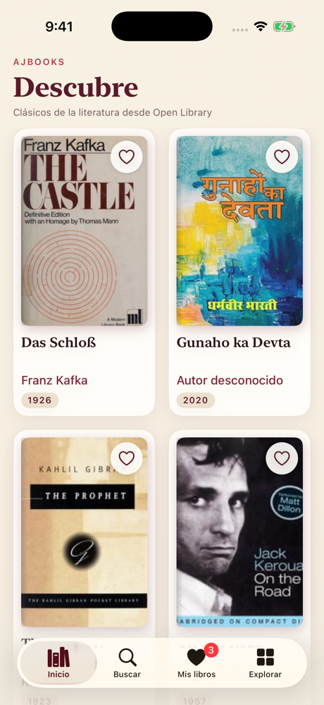
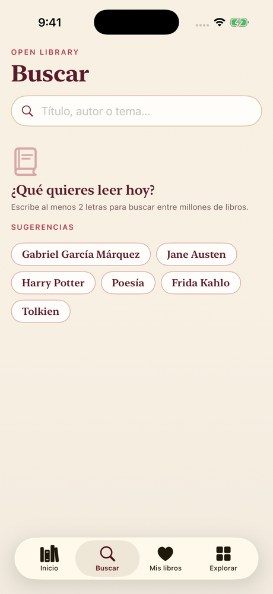
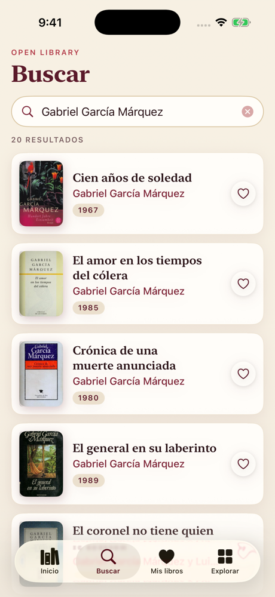
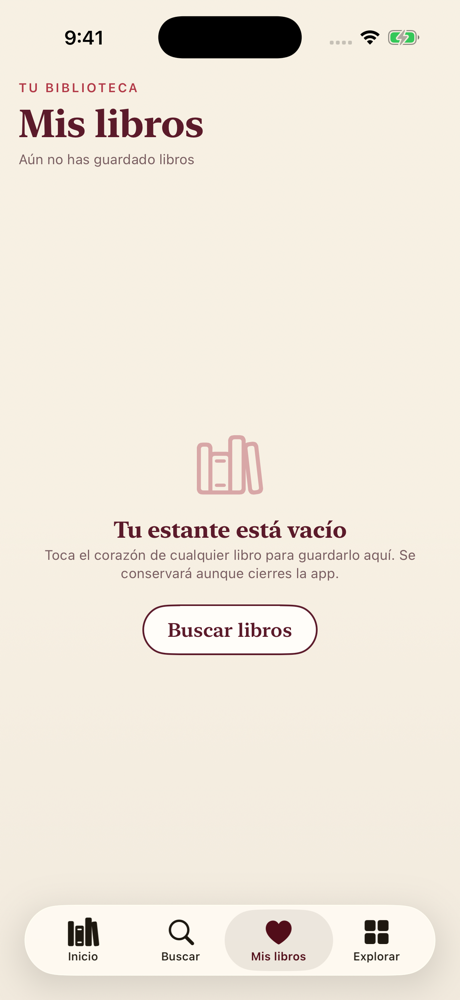
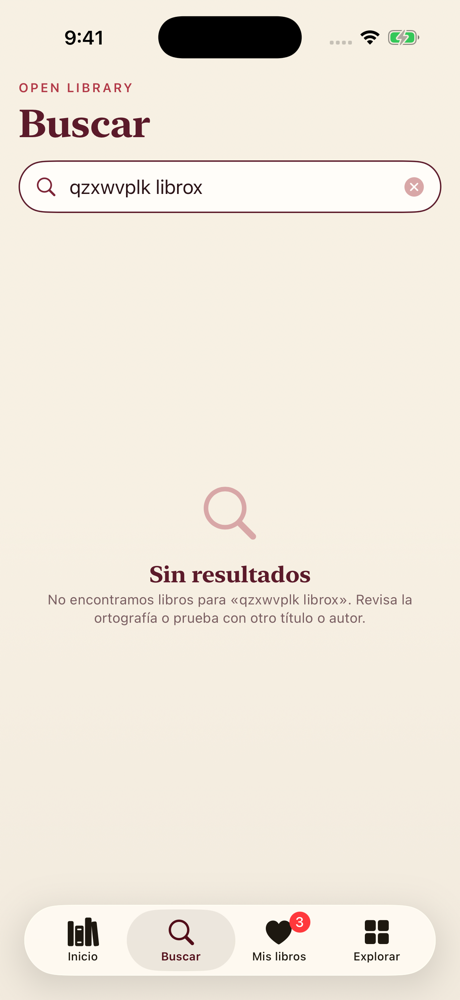

# Entrega final — Práctica 8

Revisión del repositorio, verificación funcional y evidencias de la versión que se entrega.

---

## 1. Revisión del repositorio

| Revisión | Resultado |
| :--- | :--- |
| El proyecto compila | `xcodebuild` termina con `TEST SUCCEEDED` y sin errores |
| Se puede ejecutar | Se instaló y se usó en el simulador iPhone 17 |
| Archivos temporales | Se quitaron del control de versiones `.DS_Store` y `xcuserdata/` |
| Documentos vacíos | `Docs/ARQUITECTURA.md` se completó |
| Claves, tokens o credenciales | Ninguno. Se buscaron `api key`, `token`, `secret`, `password` y `bearer` en `.swift`, `.plist`, `.json` y el proyecto sin resultados, Open Library no requiere claves |
| Archivos de configuración documentados | `project.pbxproj`, `Assets.xcassets` y `.gitignore` explicados en el README |
| Nombres y organización | Carpetas por responsabilidad (`App`, `Theme`, `Models`, `Services`, `Stores`, `Views/<pantalla>`, `ViewModels`) |

---

## 2. Pruebas ejecutadas

```bash
xcodebuild test -project AJBooks.xcodeproj -scheme AJBooks \
  -destination 'platform=iOS Simulator,name=iPhone 17' \
  -only-testing:AJBooksTests \
  -only-testing:AJBooksUITests/AJBooksUITests/testMainNavigationFlow
```

| Suite | Resultado |
| :--- | :---: |
| `BookViewModelTests` | 5 / 5 |
| `BookSearchViewModelTests` | 7 / 7 |
| `BookDetailTests` | 9 / 9 |
| `BookServiceTests` | 3 / 3 |
| `BookModelTests` | 9 / 9 |
| `FavoritesStoreTests` | 4 / 4 |
| `FavoritesViewModelTests` | 2 / 2 |
| `BookSearchTests` | 4 / 4 |
| `AJBooksUITests.testMainNavigationFlow` | 1 / 1 |
| **Total** | **44 / 44** |

---

## 3. Verificación funcional

Se probó en el simulador con una instalación limpia (sin datos previos) y conexión a internet.

| # | Funcionalidad | Pasos |
| :---: | :--- | :--- | :---: |
| 1 | Bienvenida | Abrir la app → tocar **Entrar** |
| 2 | Inicio → lista → detalle | Ver los clásicos con portada, autor y año → abrir uno |
| 3 | Lista vacía | Abrir *Mis libros* sin datos → mensaje y botón **Buscar libros** |
| 4 | Ir a buscar desde la lista vacía | Tocar **Buscar libros** → se abre la pestaña Buscar |
| 5 | Sugerencias | Buscar sin texto muestra sugerencias |
| 6 | Buscar → resultados | Tocar "Gabriel García Márquez" → 20 resultados con portada, autor y año |
| 7 | Resultados → detalle | Abrir "Cien años de soledad" → portada, título, autor, año 1967, ficha |
| 8 | Guardar desde el detalle | **Guardar en Mis libros** → cambia a **Eliminar** y la pestaña muestra 1 |
| 9 | Explorar y guardar | Categoría Novela → guardar 3 libros con el corazón |
| 10 | Mis libros → detalle | Los 4 libros aparecen con su portada (incluidos los de Explorar) |
| 11 | Eliminar | Papelera → confirmación → **Eliminar** → quedan 3 |
| 12 | Persistencia | Cerrar y volver a abrir la app → siguen los 3 libros (se revisó también `default.store`) |
| 13 | Sin resultados | Buscar "qzxwvplk librox" → mensaje con el texto buscado |
| 14 | Cargando | Indicador en listas, búsqueda, descripción y portadas |
| 15 | Sin portada | Portada vino con el título y "Sin portada" cuando Open Library no tiene imagen |
| 16 | Error y reintento | Cubierto por pruebas unitarias (`testFetchBooksHttpErrorShowsErrorMessage`, `testSearchErrorShowsMessageAndRetryRecovers`, `testLoadDescriptionErrorShowsMessage`) y por los Previews "Error" |

---

## 4. Evidencias

| Pantalla | Captura |
| :--- | :--- |
| Bienvenida |  |
| Inicio |  |
| Buscar: sugerencias |  |
| Buscar: resultados |  |
| Detalle |  |
| Detalle guardado |  |
| Mis libros vacío |  |
| Mis libros |  |
| Explorar |  |
| Confirmación al eliminar |  |
| Sin resultados |  |

---

## 5. Versión de entrega

La entrega final es el commit de la rama `Practica8` que se integra a `main` mediante el Pull Request de esta práctica, marcado con la etiqueta **`v1.0-entrega-final`**.

Para consultarla:

```bash
git checkout v1.0-entrega-final
```

---

## 6. Limitaciones y pendientes

Resumen (detalle en [ARQUITECTURA.md](ARQUITECTURA.md#6-limitaciones-conocidas)):

- Inicio, Buscar y Explorar necesitan internet, *Mis libros* funciona sin conexión, pero no la descripción del detalle.
- Algunas portadas tardan 20–30 s la primera vez porque Open Library las sirve desde archive.org.
- Máximo 20 resultados por búsqueda (sin paginación).
- Los datos (idioma del título, autores, año) dependen de Open Library.
- Sin sincronización entre dispositivos ni localización a otros idiomas.
- Requiere iOS 26.5 o superior.
