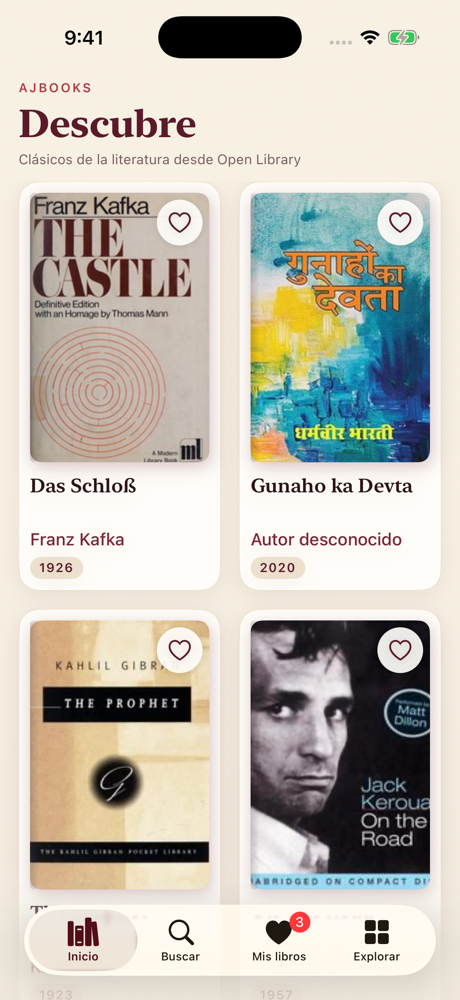
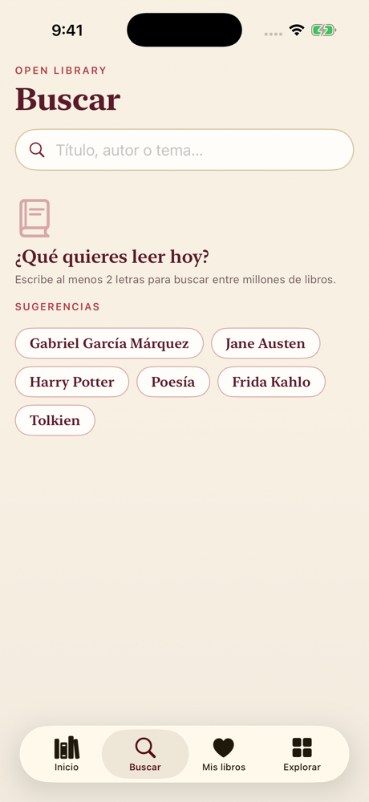
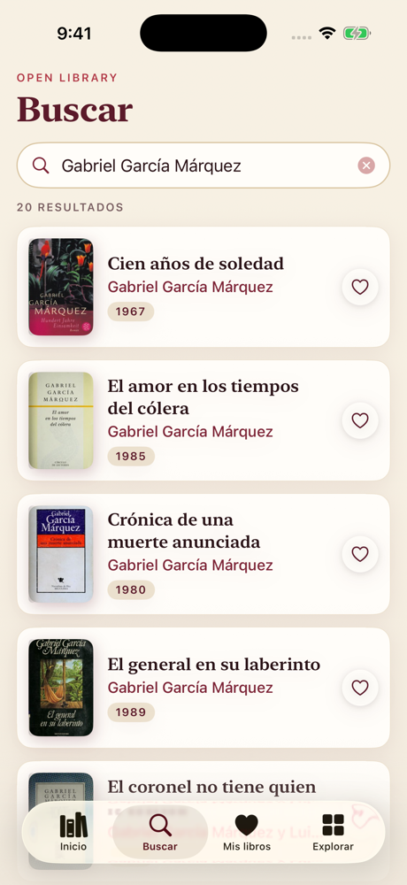
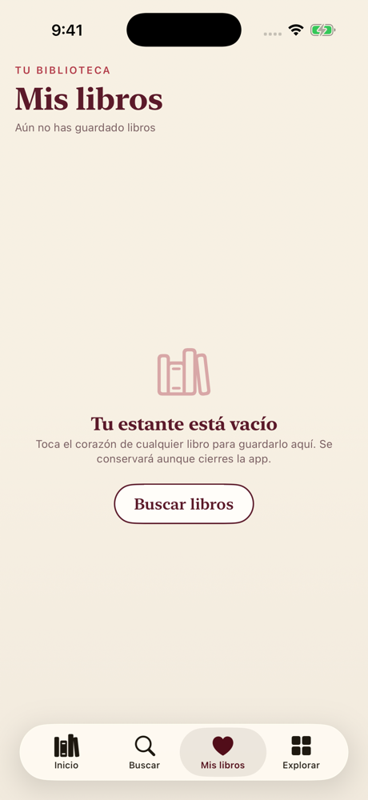
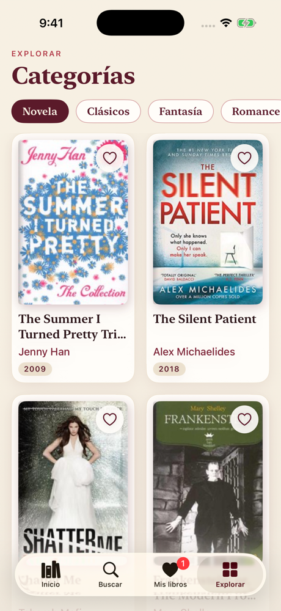
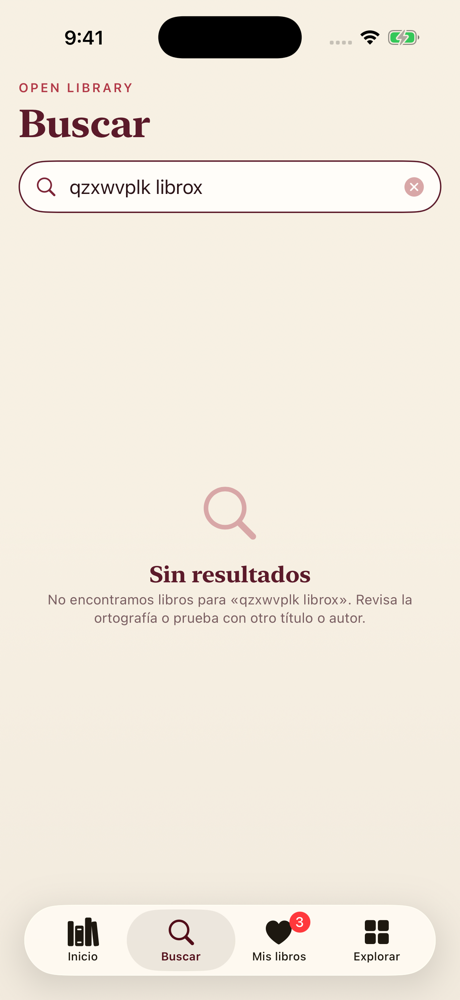

# Práctica 8: entrega final de AJBooks

## Resumen

Entrega final: documentación completa, limpieza del repositorio, revisión funcional, pruebas y capturas de la app funcionando. Versión final de la interfaz y los flujos del MVP.

> **Nota:** `main` está en la Práctica 5 porque las ramas `Practica6` y `Practica7` no se integraron. Esta rama parte de `Practica7`, así que el PR también incluye esos cambios 

## Documentación agregada o actualizada

| Archivo | Contenido |
| :--- | :--- |
| `README.md` | Cuenta con nombre, descripción, funcionalidades, tecnologías, requisitos, instalación, ejecución, servicios externos (sin claves), documentación e integrantes |
| `Docs/ARQUITECTURA.md` | Nuevo contenido: arquitectura MVVM, estructura de carpetas, endpoints, modelos de respuesta, persistencia con SwiftData, decisiones técnicas, pruebas y limitaciones conocidas |
| `Docs/ENTREGA.md` | Nuevo: revisión del repositorio, pruebas ejecutadas, verificación funcional, evidencias y versión de entrega |
| `Docs/CAMBIOS.md` | Cambios de la Práctica 8 |
| `Docs/HISTORIAL_PRACTICAS.md` | Documentación de prácticas anteriores (antes en el README) |
| `Docs/screenshots/` | 11 capturas de la app funcional|

## Cambios en la organización del repositorio

- `.gitignore` ahora excluye archivos de macOS, datos de usuario de Xcode y respaldos.
- Nueva carpeta `AJBooks/Theme/` con la paleta de colores y la tipografía
- Nuevos componentes en `Views/Components/` (`BookRowView`, `StateViews`) y `Services/CoverImageLoader.swift`
- Nuevo `ViewModels/BookSearchViewModel.swift` para la búsqueda en Open Library

## Cambios en la app

- Paleta vino / rojo / dusty pink / sand / creme / blanco, con modo oscuro, tipografía New York + SF Pro
- Consulta en Open Library
- El detalle muestra autores, año de primera publicación, Guardar/Eliminar y compartir
- Mis libros: contador, filtro, eliminar con confirmación y estado vacío con acceso a Buscar
- Explorar usa categorías reales de Open Library
- Aparecen estados de carga, error con reintento, sin resultados, sin portada y lista vacía en todas las pantallas

Detalle completo en [`Docs/ENTREGA.md`](https://github.com/Jolis-5/AJBooks/blob/Practica8/Docs/ENTREGA.md).

## Pruebas ejecutadas

**43 / 43 pruebas pasan:** 42 unitarias + 1 prueba de interfaz del recorrido principal

## Capturas

| Bienvenida | Inicio | Buscar | Resultados |
| :---: | :---: | :---: | :---: |
|  |  |  |  |

| Detalle | Guardado | Mis libros vacío | Mis libros |
| :---: | :---: | :---: | :---: |
|  |  |  |  |

| Explorar | Eliminar | Sin resultados |
| :---: | :---: | :---: |
|  |  |  |

## Limitaciones conocidas

- Algunas portadas tardan 20–30 s la primera vez (Open Library las sirve desde archive.org).
- Máximo 20 resultados por búsqueda, sin paginación
- La calidad de los datos depende de Open Library (idioma del título, autores faltantes, año)
- Sin sincronización entre dispositivos ni traducción a otros idiomas
- Requiere iOS 26.5 o superior

## Versión de entrega

- **Commit:** `COMMIT_HASH` (último commit de esta rama)
- **Etiqueta:** `v1.0-entrega-final`
