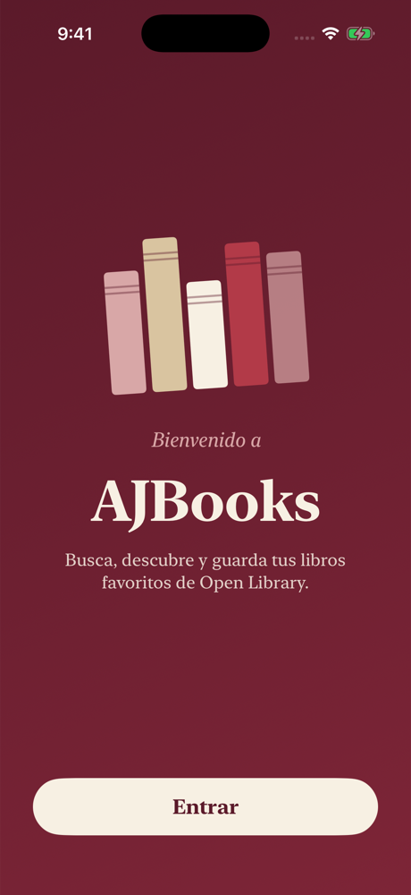
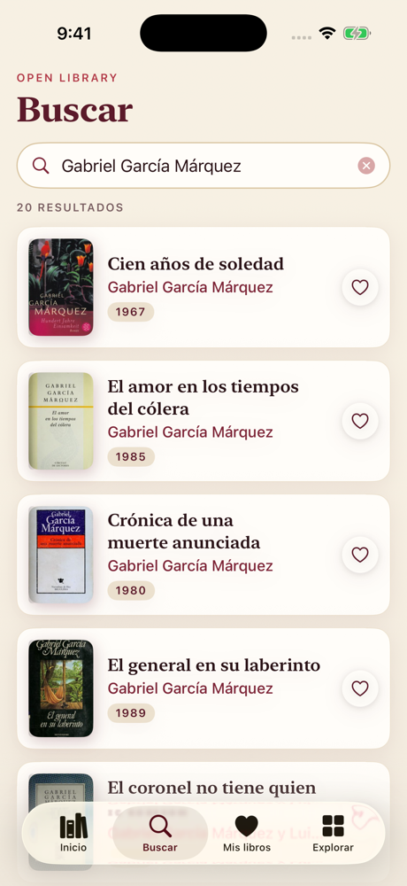
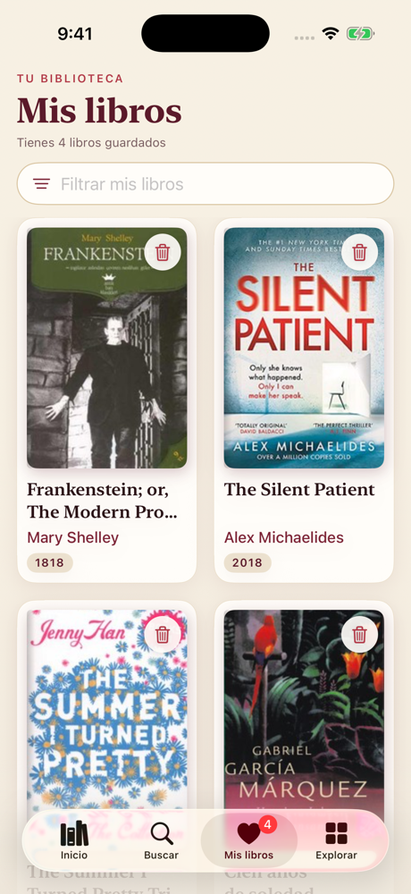

# AJBooks

**AJBooks** es una app para iPhone hecha en SwiftUI que permite buscar libros en el catálogo abierto de [Open Library](https://openlibrary.org), consultar su ficha (portada, autores y año de publicación) y guardarlos en una biblioteca personal que se conserva en el dispositivo.

<p align="center">
  
  
  
  
</p>

---

## Descripción

Cuando alguien quiere recordar un libro que le recomendaron, revisar quién lo escribió o cuándo se publicó, la información suele estar repartida entre tiendas en línea, notas sueltas y capturas de pantalla.

AJBooks reúne eso en un solo lugar:
- **busca** cualquier libro por título, autor o tema en un catálogo de millones de obras,
- muestra una **ficha clara** de cada libro,
- permite **guardar** los que interesan en *Mis libros*, una lista que sigue disponible aunque se cierre la app o no haya internet.

La app no vende ni presta libros: su propósito es descubrir libros y llevar una lista personal de lectura.

---

## Funcionalidades

| Funcionalidad | Detalle |
| :--- | :--- |
| **Bienvenida** | Pantalla de entrada con la identidad visual de la app |
| **Inicio** | Lista de libros clásicos de la literatura desde Open Library, se recarga deslizando hacia abajo |
| **Buscar** | Búsqueda en Open Library mientras se escribe (mínimo 2 letras) y sugerencias para empezar |
| **Resultados** | Portada (si existe), título, autor(es) y año de cada libro |
| **Detalle** | Portada, título, autores, año de primera publicación, descripción (si existe) y botón para compartir el enlace de Open Library |
| **Guardar y eliminar** | Con el corazón de cada tarjeta, el botón del detalle, el menú o la papelera de *Mis libros* (pide confirmación) |
| **Mis libros** | Libros guardados del más reciente al más antiguo, con contador, filtro local y el número de libros en la pestaña |
| **Persistencia local** | Los libros guardados se conservan al cerrar la app |
| **Explorar** | Libros por categoría: Novela, Clásicos, Fantasía, Romance, Poesía, Infantil, Ciencia e Historia |
| **Estados de pantalla** | Cargando, error con *Reintentar*, sin resultados, sin portada y lista vacía |
| **Diseño** | Paleta vino / rojo / dusty pink / sand / creme / blanco, tipografía New York + SF Pro, modo oscuro y Dynamic Type |

### Flujos principales
1. **Inicio → lista de libros → detalle**
2. **Buscar → resultados → detalle**
3. **Mis libros → libro guardado → detalle**

---

## Tecnologías

| Tipo | Herramienta |
| :--- | :--- |
| Lenguaje | Swift 5 (modo de lenguaje) |
| Interfaz | SwiftUI (`NavigationStack`, `TabView`, `Layout` personalizado) |
| Estado | Framework Observation (`@Observable`, `@State`, `@Environment`) |
| Persistencia | SwiftData (`@Model`, `ModelContainer`) |
| Red | `URLSession` con `async/await` y `Codable` |
| Pruebas | XCTest (pruebas unitarias y de interfaz) |
| IDE | Xcode 26 |
| Servicio externo | Open Library Search API, Works API y Covers API |
| Control de versiones | Git y GitHub |


---

## Requisitos

| Requisito | Versión |
| :--- | :--- |
| macOS | Uno que pueda ejecutar Xcode 26 |
| Xcode | 26.0 o superior (probado con **Xcode 26.6**) |
| iOS de destino | **26.5** o superior (simulador o iPhone) |
| Simulador recomendado | iPhone 17 o iPhone 17 Pro |

---

## Instalación y configuración

1. Clona el repositorio:

```bash
git clone https://github.com/Jolis-5/AJBooks.git
```

2. Abre el proyecto en Xcode:

```bash
open AJBooks/AJBooks.xcodeproj
```

3. Si Xcode pide descargar la plataforma iOS 26, acepta (*Xcode → Settings → Components*).
4. **Simulador:** no hace falta configurar nada.
5. **iPhone físico:** en *Target AJBooks → Signing & Capabilities*, elige tu propio *Team* (el proyecto trae el equipo de la autora) y, si Xcode lo pide, cambia el *Bundle Identifier* (`FCA.AJBooks`) por uno único.

### Archivos de configuración

| Archivo | Para qué sirve |
| :--- | :--- |
| `AJBooks.xcodeproj/project.pbxproj` | Targets, versión mínima de iOS (26.5), firma, bundle id y carpetas sincronizadas |
| `AJBooks/Assets.xcassets` | Ícono de la app y `AccentColor` (vino) |
| `.gitignore` | Excluye `.DS_Store`, `xcuserdata/`, `DerivedData/` y otros archivos locales |

---

## Ejecución

### Desde Xcode
1. Elige el esquema **AJBooks**.
2. Elige un simulador (por ejemplo **iPhone 17**).
3. Presiona **⌘R**.
4. Toca **Entrar** en la bienvenida.

### Pruebas
- En Xcode: **⌘U**.
- Desde la terminal (en la carpeta del repositorio), solo pruebas unitarias:

```bash
xcodebuild test -project AJBooks.xcodeproj -scheme AJBooks -destination 'platform=iOS Simulator,name=iPhone 17' -only-testing:AJBooksTests
```

- Prueba de interfaz del recorrido principal:

```bash
xcodebuild test -project AJBooks.xcodeproj -scheme AJBooks -destination 'platform=iOS Simulator,name=iPhone 17' -only-testing:AJBooksUITests/AJBooksUITests/testMainNavigationFlow
```

Si tu Mac no tiene ese simulador, cambia `name=iPhone 17` por uno de los que aparecen con `xcrun simctl list devices available`.

---

## Configuración de servicios externos

La app usa la API pública de **Open Library** :

| Servicio | URL base |
| :--- | :--- |
| Búsqueda y fichas | `https://openlibrary.org` |
| Portadas | `https://covers.openlibrary.org` |

- **No requiere clave, token, registro ni configuración.** No hay credenciales en el repositorio.
- Las URL están definidas en `AJBooks/Services/BookService.swift` (`baseURL`) y en `AJBooks/Models/Books.swift` (`coverURL(size:)`).
- Ambas usan HTTPS, así que no hace falta configurar *App Transport Security*.
- Open Library pide un uso razonable de su servicio, la app limita cada búsqueda a 20 resultados y espera a que el usuario deje de escribir antes de consultar.

Los detalles de los endpoints y los modelos están en la [documentación técnica](Docs/ARQUITECTURA.md#2-networking).

---

## Documentación

| Documento | Contenido |
| :--- | :--- |
| [Docs/ARQUITECTURA.md](Docs/ARQUITECTURA.md) | Arquitectura, networking, persistencia, decisiones técnicas, pruebas y limitaciones conocidas |
| [Docs/ENTREGA.md](Docs/ENTREGA.md) | Revisión final del repositorio, verificación funcional y evidencias |
| [Docs/PULL_REQUEST.md](Docs/PULL_REQUEST.md) | Descripción del Pull Request de la entrega final |
| [Docs/CAMBIOS.md](Docs/CAMBIOS.md) | Registro de cambios por práctica |
| [Docs/HISTORIAL_PRACTICAS.md](Docs/HISTORIAL_PRACTICAS.md) | Documentación de prácticas anteriores |
| [Docs/screenshots](Docs/screenshots) | Capturas de la app funcionando |

---

## Integrantes

| Nombre | GitHub |
| :--- | :--- |
| Jolette Rivera | [@Jolis-5](https://github.com/Jolis-5) |
| Abigail Hernández | [@abigail-hernandez](https://github.com/abigail-hernandez) |

---
